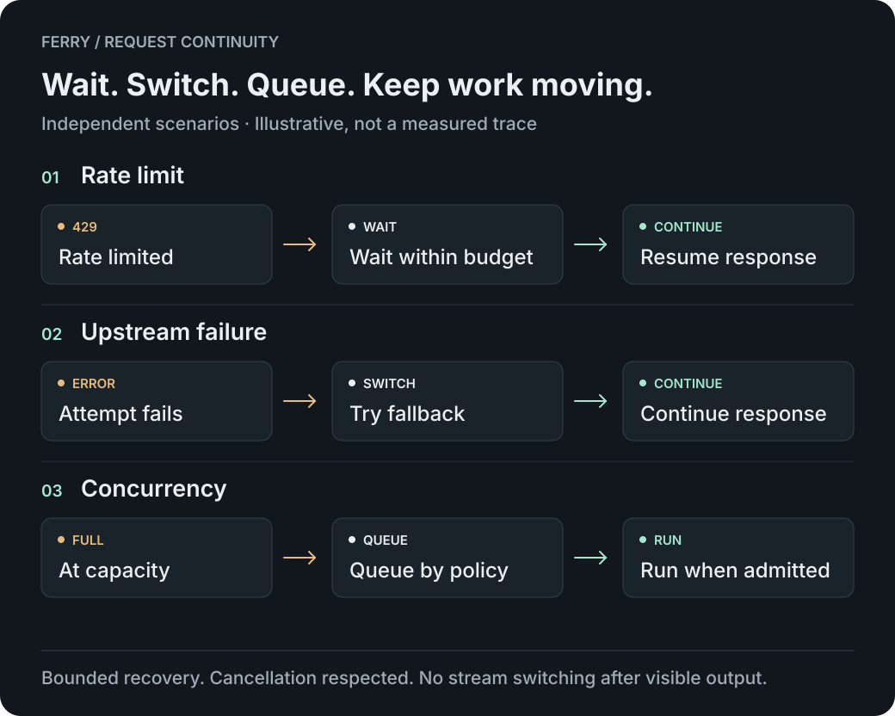
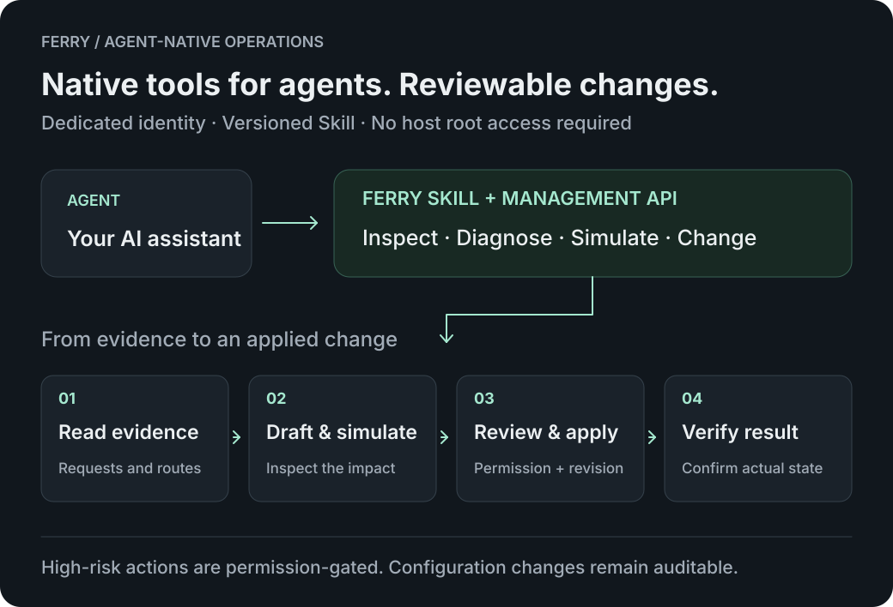

<p align="center"><picture><source media="(prefers-color-scheme: dark)" srcset="web/console/brand-reverse.svg"></picture></p>

# Ferry

**Less time retrying.<br>More time for your AI to work.**

A self-hosted gateway for long-running AI tasks. Wait through rate limits, switch failed upstreams and queue traffic at capacity. Give clients one stable endpoint—and agents a Skill and management API they can use directly.

[中文](README.md) · **English**

[Website](https://ferry.bighulk.dev/) · **[Get started →](docs/guide/quickstart.md)** · [Configure recovery](docs/guide/long-tasks.md) · [Let your agent manage Ferry](docs/guide/agent-skill.md) · [Documentation](docs/README.md)


You give work to an agent because you want to come back to progress. Ferry handles upstream routing, waiting and recovery, so a `429`, a broken connection or a burst of traffic needs less of your attention.

## Start on your own machine

One Go process, an embedded console and local SQLite, built for individuals and small teams. No Node.js or external database is needed at runtime. You retain control of upstream credentials, configuration and request records.

Release preparation: the `0.1.1` image and download URLs are not public yet. The installation below becomes available after public release verification.

### Start with Docker

In an empty directory, with Docker and Compose installed:

```sh
curl -fsSLo compose.yaml https://github.com/hulkbig/ferry/releases/download/v0.1.1/compose.yaml
docker compose up -d
```

Open **<http://localhost:17910>** and create your administrator. No source checkout, compilation, `.env` file or separate database is needed. The inference base URL is `http://localhost:17810/v1`; a named volume retains configuration and request data.

**[Docker installation, remote access and upgrades →](docs/guide/docker.en.md)**

<details>
<summary>Run from source (Go)</summary>

Use the Go version in `go.mod`, currently **1.26.10**:

```sh
go run ./cmd/ferry -data-dir ./data -config ./config.example.yaml
```

Open **<http://127.0.0.1:7900>** and initialize the administrator immediately. The inference base URL is `http://127.0.0.1:7890/v1`. Both example listeners bind to loopback.

The YAML file initializes an empty database once. Subsequent configuration is stored in SQLite and edited through the console or management API.

</details>

### Connect your agent

1. Add a provider, credentials, exact upstream model ID and protocol in **Providers**.
2. Check routing and enable the required connections in **Models & Routing**.
3. Create a dedicated inference key in **API Keys**. Set your client's base URL, key and logical model name.

Complete a [first request](docs/guide/quickstart.md), then configure [fallback routes and recovery conditions](docs/guide/long-tasks.md). Verify tools and follow-up turns with your actual client. Keys can restrict models, protocols, expiration, RPM and budgets.

### Send a request. Pick a route.



### Return the result. Keep working.



### Primary fails. A fallback takes over.



### Rate limited? Wait, then continue.



### Change models. Keep your integration.

Your app calls a logical model such as `work`, rather than a vendor-specific model ID. Change the underlying model, account or route in Ferry without changing client configuration.

Hermes is one example: point it at `work`, connect existing subscriptions or APIs behind that name, and choose models for the task. [Configure logical models](docs/guide/logical-models.en.md) · [Hermes example](docs/guide/hermes.en.md).



### Redeem credits before they expire

AutoReset redeems available Codex reset credits within the expiry threshold and records the upstream outcome. Default: 20 minutes before expiry; can be disabled. Reset eligibility is decided upstream. See [AutoReset settings](docs/guide/autoreset.en.md).



These six SVG animations illustrate independent scenarios, not live traffic. Recovery depends on routing, compatibility and waiting budgets. The [website](https://ferry.bighulk.dev/) adds pause and replay controls; reduced-motion mode keeps a static diagram.

## Keep the work moving

### 01 · Wait through limits. Resume automatically.

When an upstream such as Codex is rate-limited, Ferry can keep the request pending within its recovery window and resume when conditions allow. This reduces manual retries. The client may continue to show a processing state; whether it says “Thinking” depends on the client.

### 02 · Upstream fails. A fallback takes over.

Connection failures, transient 5xx responses and enabled first-output timeouts can trigger recovery under your routing policy. When the preferred route is unavailable, an eligible fallback can take over.

### 03 · Bound concurrency. Queue the peaks.

Set concurrency limits globally, per provider or per connection. Queue excess traffic according to policy, turning bursts into paced requests and reducing the risk of hitting upstream limits.



Recovery respects configuration, time and attempt budgets, and client cancellation. First-output timeouts must be enabled per model. Once visible output has been committed, Ferry does not splice in a different upstream stream. See the [long-task guide](docs/guide/long-tasks.md).

## Give your agent the tools to manage it

### 04 · Agent-friendly. Built for direct operation.

Ferry ships a versioned Skill and management API. Agents can inspect configuration, diagnose requests, simulate routing, prepare drafts and apply changes within their authorization. They use a dedicated management identity without needing host root access or an administrator password.

Start with a concrete task:

> Explain why this request did not recover. Check the fallback routes, simulate an adjustment, and show which requests it would affect.



[Install the Ferry Skill →](docs/guide/agent-skill.md)

### 05 · Test capabilities. Match the request.

Verify tools, reasoning, streaming and other capabilities for selected models, endpoints and protocols, then use that evidence in routing. When an exact match is unavailable, registered compatibility mappings can retain a usable path—for example, mapping parallel tools to serial tools and recording the change. Enable `exact_only` when exact compatibility is required.

Probes can incur upstream charges. See [protocol behavior](docs/protocol-fidelity.md) for support and conversion rules.

## Keep your client. Choose your upstreams.

### 06 · Stable endpoint. Flexible models.

Clients keep one logical model name. Arrange the actual models, accounts and fallback routes in Ferry, with rules by caller, protocol and time window. Change upstreams without reconfiguring each client.

### 07 · Three protocols. One gateway.

OpenAI Chat, Responses and Anthropic Messages are first-class endpoints, with matching native protocols preferred. Keep your familiar client and use tools, reasoning and streaming according to the actual route's capabilities. Native image generation and editing have separate endpoints.

[Explore client examples →](docs/guide/api.md)

## Know what happened

### 08 · Every request. Evidence you can inspect.

See the selected route, upstream attempts, excluded candidates, waiting and recovery decisions, usage and cost basis under one client request. An upstream attempt can fail while the client request ultimately succeeds; the records distinguish the two.

[Troubleshoot a request →](docs/guide/troubleshooting.md)

## Providers and scope

API key providers support preset addresses and custom compatible endpoints. Native account drivers cover Claude, Kimi (com/ai), xAI, Meta, Vertex, Antigravity and Devin. Codex has a separate OAuth lifecycle. Ferry does not require an external CLIProxyAPI process.

The new native drivers have offline test coverage; live login and inference have not been verified for every driver. Check [provider support](docs/provider-channel-coverage.md) for account requirements, model access and driver limits. Ferry does not supply upstream accounts or credits.

<details>
<summary>Before deployment: data, access and costs</summary>

- Run one process per local data directory, with one administrator. Shared SQLite replicas and a multi-tenant administrator console are not supported.
- Initialize before allowing network access. Use TLS and access restrictions for remote administration.
- Databases contain credentials and request records; default backups contain only current configuration and recovery credentials. Neither is encrypted at rest by default. Add `-backup-history` explicitly to back up full history. Use the [built-in backup and restore commands](docs/guide/operations.md) rather than copying live `.db` files.
- Cost estimates depend on recorded usage and configured prices. They do not replace provider invoices; recovery attempts, probes and scheduled messages can incur additional charges.
- Concurrency control manages request pacing; it does not guarantee that an upstream account will avoid suspension.

</details>

## Help the next task keep moving

A reproducible tool-call issue, accurate provider capability evidence or a clearer installation step can help the next person using Ferry. See [Contributing](CONTRIBUTING.en.md).

| Next step | Documentation |
| --- | --- |
| Common questions and troubleshooting | [FAQ](docs/guide/faq.en.md) · [Troubleshooting](docs/guide/troubleshooting.en.md) |
| Browse English guides | [Documentation](docs/README.en.md) |
| Configure models, connections and identities | [Configuration](docs/guide/configuration.md) |
| Back up, upgrade or migrate | [Operations](docs/guide/operations.md) · [Migrate from SmartAPI](docs/guide/migration.md) |
| Change code and run checks | [Development](docs/development.en.md) |
| Inspect illustration purpose and provenance | [Illustrations](docs/assets/README.md) · [Asset sources](docs/asset-provenance.md) |

```sh
bash scripts/test.sh
```

Checks require Go, Node.js, npm and Python 3. The console has no npm runtime dependencies.

## License

Copyright 2026 hulkbig. Original contributions are licensed under [Apache-2.0](LICENSE). Third-party material retains its license; CLIProxyAPI-derived OAuth and native protocol portions retain their MIT notices. See [NOTICE](NOTICE), [LICENSES](LICENSES) and [Security policy](SECURITY.en.md).
