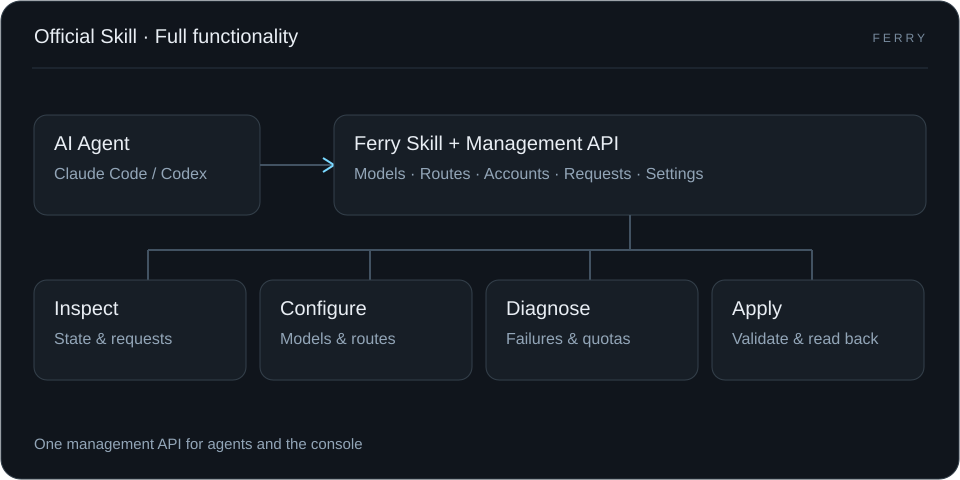
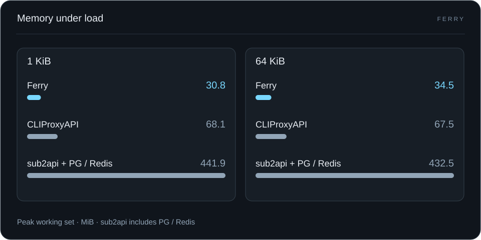
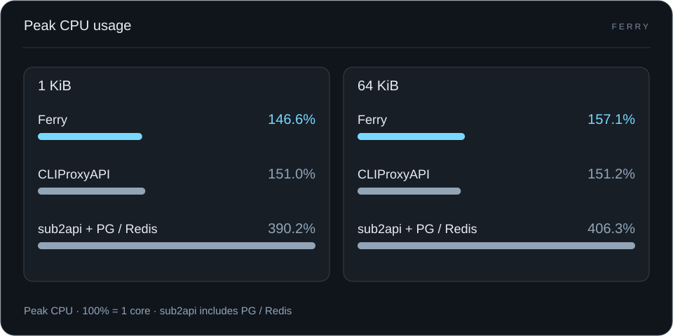
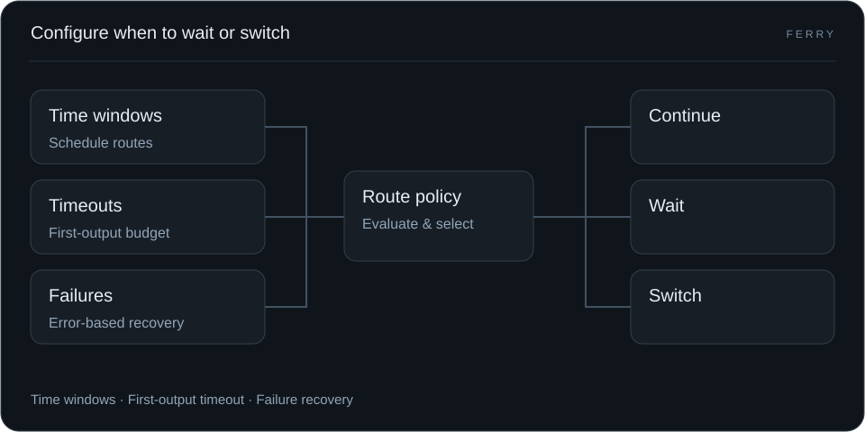

<p align="center"><picture><source media="(prefers-color-scheme: dark)" srcset="web/console/brand-reverse.svg"></picture></p>

# Ferry

**Self-hosted AI gateway. Go + SQLite. Docker and headless deployment.**

A self-hosted gateway for long-running AI tasks. Wait through rate limits, switch failed upstreams and queue traffic at capacity. Give clients one stable endpoint—and agents a Skill and management API they can use directly.

[中文](README.md) · **English**

[Website](https://ferry.bighulk.dev/) · **[Get started →](docs/guide/quickstart.md)** · [Configure recovery](docs/guide/long-tasks.md) · [Let your agent manage Ferry](docs/guide/agent-skill.md) · [Documentation](docs/README.md)


## Start on your own machine

One Go process, an embedded console and local SQLite, built for individuals and small teams. No Node.js or external database is needed at runtime. You retain control of upstream credentials, configuration and request records.


### Start with Docker

In an empty directory, with Docker and Compose installed:

```sh
curl -fsSLo compose.yaml https://github.com/hulkbig/ferry/releases/latest/download/compose.yaml
docker compose up -d --no-build
```

Open **<http://localhost:17910>** and create your administrator. No source checkout, compilation, `.env` file or separate database is needed. The inference base URL is `http://localhost:17810/v1`; a named volume retains configuration and request data.

**[Docker installation, remote access and upgrades →](docs/guide/docker.en.md)**

[Development and source builds](docs/development.en.md)

### Connect your agent

1. Add a provider, credentials, exact upstream model ID and protocol in **Providers**.
2. Check routing and enable the required connections in **Models & Routing**.
3. Create a dedicated inference key in **API Keys**. Set your client's base URL, key and logical model name.

Complete a [first request](docs/guide/quickstart.md), then configure [fallback routes and recovery conditions](docs/guide/long-tasks.md). Verify tools and follow-up turns with your actual client. Keys can restrict models, protocols, expiration, RPM and budgets.

## AI First

### Official Skill, full functionality

From models, accounts and routes to request diagnostics, quota management and daily operations, agents access Ferry's full management capabilities through the official Skill.



[Install the official Skill](docs/guide/agent-skill.md)

### Logical models: built around your business

Define model endpoints for your business. Change upstream models, accounts and routes inside Ferry while keeping your application configuration unchanged.


[Configure logical models](docs/guide/logical-models.en.md)

## Extreme Performance

### Lower memory usage

In the OpenAI Chat Mock benchmark, Ferry's peak working set was **30.8–34.5 MiB**: about **49%–55% lower than CLIProxyAPI** and **92%–93% lower than the sub2api stack**.



### Lower CPU usage

Ferry’s peak CPU usage is close to CLIProxyAPI and lower than the sub2api stack: **146.6%–157.1%**, **151.0%–151.2%** and **390.2%–406.3%**, respectively.



Benchmark: OpenAI Chat Mock · ARM64 · concurrency 32 · 1 KiB / 64 KiB responses · 2026-10-30. [Methods and full data](docs/guide/performance.en.md)

## Reliable Requests

### Automatic failover

When the primary upstream fails, automatically try a compatible fallback.


### Configurable switching policies

Choose when to wait or switch using time windows, first-output timeouts and failure types.



[Configure switching policies](docs/guide/long-tasks.md)

### Queue requests, see fewer 429s

Wait within configured budgets when capacity is unavailable, then continue when it opens.


### Automatic resets and quota protection

Automatically redeem available Codex reset credits and use quota protection to reduce requests to exhausted accounts.


[Automatic resets](docs/guide/autoreset.en.md) · [Quota protection](docs/guide/codex-usage-protection.en.md)

## Providers and scope

API key providers support preset addresses and custom compatible endpoints. Native account drivers cover Claude, Kimi (com/ai), xAI, Meta, Vertex, Antigravity and Devin. Codex has a separate OAuth lifecycle. Ferry does not require an external CLIProxyAPI process.

The new native drivers have offline test coverage; live login and inference have not been verified for every driver. Check [provider support](docs/provider-channel-coverage.md) for account requirements, model access and driver limits. Ferry does not supply upstream accounts or credits.

<details>
<summary>Before deployment: data, access and costs</summary>

- Run one process per local data directory, with one administrator. Shared SQLite replicas and a multi-tenant administrator console are not supported.
- Initialize before allowing network access. Use TLS and access restrictions for remote administration.
- Databases contain credentials and request records; default backups contain only current configuration and recovery credentials. Neither is encrypted at rest by default. Add `-backup-history` explicitly to back up full history. Use the [built-in backup and restore commands](docs/guide/operations.md) rather than copying live `.db` files.
- Cost estimates depend on recorded usage and configured prices. They do not replace provider invoices; recovery attempts, probes and scheduled messages can incur additional charges.
- Concurrency control manages request pacing; it does not guarantee that an upstream account will avoid suspension.

</details>

## Help the next task keep moving

A reproducible tool-call issue, accurate provider capability evidence or a clearer installation step can help the next person using Ferry. See [Contributing](CONTRIBUTING.en.md).

| Next step | Documentation |
| --- | --- |
| Common questions and troubleshooting | [FAQ](docs/guide/faq.en.md) · [Troubleshooting](docs/guide/troubleshooting.en.md) |
| Browse English guides | [Documentation](docs/README.en.md) |
| Configure models, connections and identities | [Configuration](docs/guide/configuration.md) |
| Back up, upgrade or migrate | [Operations](docs/guide/operations.md) · [Migrate from SmartAPI](docs/guide/migration.md) |
| Change code and run checks | [Development](docs/development.en.md) |
| Inspect illustration purpose and provenance | [Illustrations](docs/assets/README.md) · [Asset sources](docs/asset-provenance.md) |

```sh
bash scripts/test.sh
```

Checks require Go, Node.js, npm and Python 3. The console has no npm runtime dependencies.

## License

Copyright 2026 hulkbig. Original contributions are licensed under [Apache-2.0](LICENSE). Third-party material retains its license; CLIProxyAPI-derived OAuth and native protocol portions retain their MIT notices. See [NOTICE](NOTICE), [LICENSES](LICENSES) and [Security policy](SECURITY.en.md).
