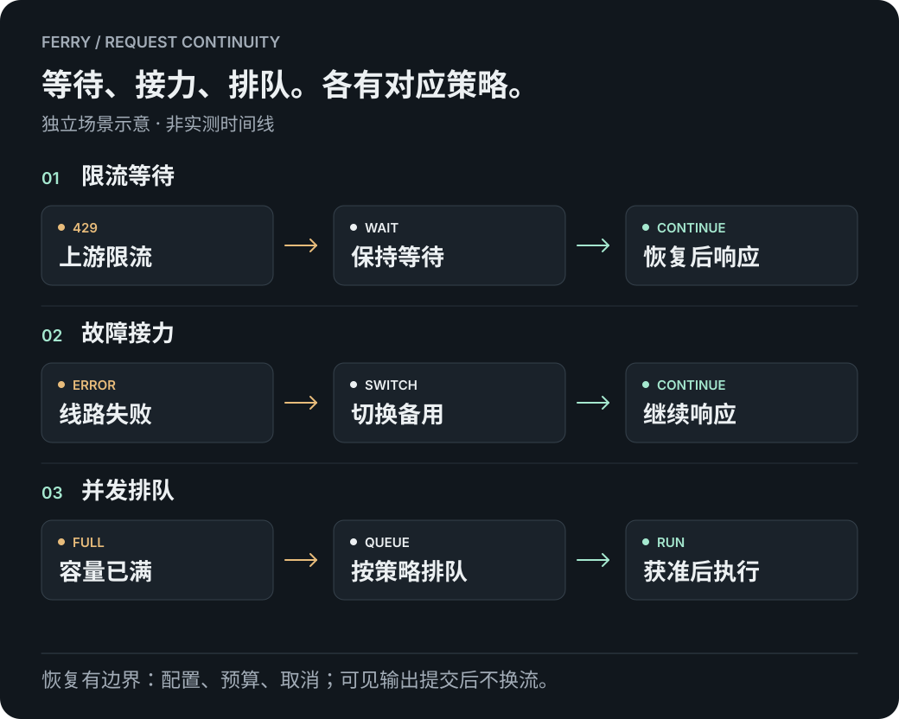
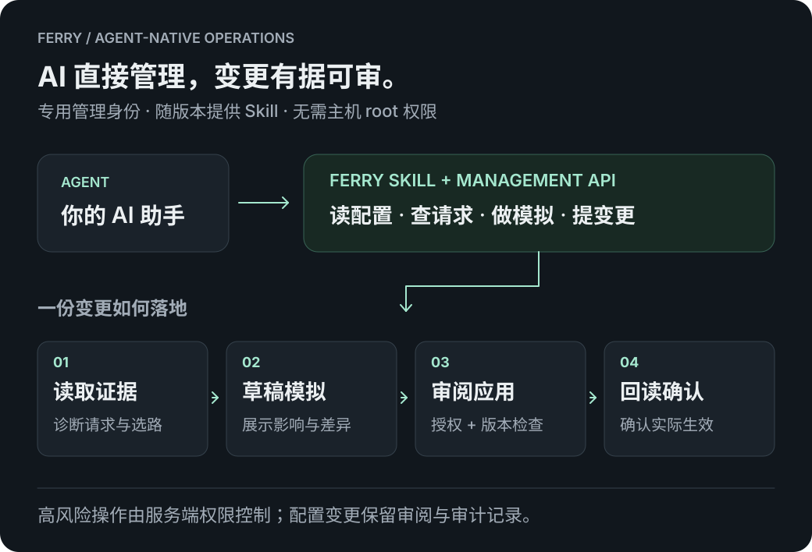

<p align="center"><picture><source media="(prefers-color-scheme: dark)" srcset="web/console/brand-reverse.svg"></picture></p>

# Ferry 渡口

**少守着重试，让 AI 继续干活。**

为 AI 长任务设计的自托管网关。限流时等待，故障时接力，高峰时排队。客户端使用一个稳定入口，AI 通过 Skill 和管理 API 直接参与运维。

**中文** · [English](README.en.md)

[官网](https://ferry.bighulk.dev/) · **[开始使用 →](docs/guide/quickstart.md)** · [配置长任务恢复](docs/guide/long-tasks.md) · [让 AI 接手运维](docs/guide/agent-skill.md) · [全部文档](docs/README.md)


你把任务交给 Agent，是想回来看到工作向前推进。Ferry 接下上游选路、等待与恢复，让你少为一次 `429`、一条坏线路或一阵请求高峰回到电脑前。

## 在自己的机器上开始

Go 单进程、嵌入式控制台、本地 SQLite，面向个人和小团队。运行时无需 Node.js 或外部数据库，上游凭据、配置和请求记录由你保管。

发布准备：`0.1.0` 镜像和下载地址尚未公开。以下是正式版的安装入口，公开验收完成后即可直接使用。

### Docker 两步启动

在空目录执行（需要 Docker 和 Compose）：

```sh
curl -fsSLo compose.yaml https://github.com/hulkbig/ferry/releases/download/v0.1.0/compose.yaml
docker compose up -d
```

打开 **<http://localhost:17910>** 创建管理员。无需源码、编译、`.env` 或独立数据库。推理 API 为 `http://localhost:17810/v1`，配置和记录保存在命名卷中。

**[Docker 安装、服务器访问与升级 →](docs/guide/docker.md)** · [首次请求](docs/guide/quickstart.md)

<details>
<summary>从源码运行（Go）</summary>

安装 `go.mod` 指定的 Go 版本（当前为 **1.26.10**）：

```sh
go run ./cmd/ferry -data-dir ./data -config ./config.example.yaml
```

打开 **<http://127.0.0.1:7900>**，立即创建管理员。推理 API 位于 `http://127.0.0.1:7890/v1`。示例仅监听本机。

`config.example.yaml` 只用于空库首次初始化，后续配置保存在 SQLite，通过控制台或管理 API 修改。

</details>

### 连上你的 Agent

1. 在 **渠道（Providers）** 中添加上游，填写凭据、准确模型 ID 和协议。
2. 在 **模型与路由（Models & Routing）** 中检查路由并启用所需连接。
3. 在 **API 密钥（API Keys）** 中创建专用推理 Key，设置客户端的 Base URL、Key 和逻辑模型名。

先完成[第一个请求](docs/guide/quickstart.md)，再配置[备用路由和恢复条件](docs/guide/long-tasks.md)，用实际客户端验证工具调用与续轮。Key 可以限制模型、协议、有效期、RPM 和预算。

### 请求发出，选好线路



### 结果返回，继续执行



### 首选故障，备用接力



### 遇到限流，排队再走



### 模型可换，业务照常

业务使用 `work` 这样的逻辑模型名，不绑定某个厂商的具体模型。换模型、换账号、调线路，都在 Ferry 中完成，客户端配置不用跟着改。

Hermes 是一个例子：给它配置 `work`，背后可以连接已有的订阅或 API，按任务需要调整模型。[逻辑模型配置](docs/guide/logical-models.md) · [Hermes 接入案例](docs/guide/hermes.md)。



### 重置券快过期，自动兑换

AutoReset 在到期阈值内兑换可用的 Codex 重置券，并记录上游结果。默认提前 20 分钟，可关闭；能否重置由上游判定。[设置说明](docs/guide/autoreset.md)。



六张 SVG 动画是独立场景示意，不是真实流量。恢复受路由、兼容性和等待预算约束。[官网](https://ferry.bighulk.dev/)提供暂停与重播；减少动态效果模式下保留静态示意。

## 先把任务接住

### 01 · 限流等待，自动续接

遇到 Codex 等上游限流，在恢复窗口内保持请求等待，条件允许后自动继续响应，减少手动重试。客户端可以保持“处理中”；具体是否显示 Thinking，由客户端决定。

### 02 · 上游故障，自动接力

连接失败、短暂 5xx，或启用后的首个输出超时，都可以按路由策略触发恢复。首选线路暂时不可用，就让符合任务要求的备用线路接手。

### 03 · 并发可控，高峰排队

按全局、渠道或连接设置并发上限，超出容量按策略排队。把突发请求变成有节奏的调用，减少触发限流的风险。



恢复受配置、时间和次数预算约束，并响应客户端取消。首输出超时需要按模型启用；已经提交可见输出的流不会被另一条上游流拼接替换。配置步骤见[长任务指南](docs/guide/long-tasks.md)。

## AI 自己会用，你少做运维

### 04 · AI 友好，自助运维

随版本提供 Skill 和管理 API。AI 可以读取配置、诊断请求、模拟选路、准备草稿，并在授权范围内完成变更。使用专用管理身份，无需主机 root 权限或管理员密码。

把一个具体问题交给它：

> 查看这次请求为什么没有恢复。检查备用线路，模拟调整方案，展示变更会影响哪些请求。



[安装 Ferry Skill →](docs/guide/agent-skill.md)

### 05 · 能力实测，按需匹配

对选定的模型、端点和协议验证工具、推理、流式等能力，再据此选路。精确匹配不可用时，已注册的兼容映射可以保留可执行路径，例如将并行工具要求映射到串行工具，并记录变化。需要严格保真的任务可启用 `exact_only`。

探测可能产生上游费用，支持范围见[协议说明](docs/protocol-fidelity.md)。

## 客户端照旧，上游随你

### 06 · 入口不变，模型可换

客户端始终调用一个逻辑模型名，实际模型、账号和备用线路在 Ferry 中安排。按调用方、协议和时间窗口调整路由，上游变化时不用逐个修改客户端。

### 07 · 三种协议，统一接入

OpenAI Chat、Responses、Anthropic Messages 都是一等入口，优先选择匹配的原生协议。继续使用熟悉的客户端，按实际线路能力处理工具调用、推理和流式响应。另提供独立的原生图片生成与编辑入口。

[查看客户端接入示例 →](docs/guide/api.md)

## 出了问题，看得明白

### 08 · 请求过程，有据可查

一次客户端请求下，集中查看实际线路、每次上游尝试、候选排除、等待与恢复原因，以及用量和费用依据。一次上游失败后可能已经恢复成功；请求记录让你分清每次尝试和最终结果。

[从一次请求开始排障 →](docs/guide/troubleshooting.md)

## 渠道与使用范围

API Key 渠道支持预设地址和自建兼容端点。原生账号驱动包括 Claude、Kimi 国内／国际、xAI、Meta、Vertex、Antigravity 和 Devin；Codex 使用独立 OAuth 流程。Ferry 不要求运行外部 CLIProxyAPI 服务。

新增原生驱动已通过离线测试，尚未逐一完成真实账号登录和推理验证。账号权限、模型开放范围及各驱动限制见[渠道支持](docs/provider-channel-coverage.md)。Ferry 不提供上游账号或额度。

<details>
<summary>部署前了解：数据、权限与费用</summary>

- 每个数据目录只运行一个实例，采用单管理员模式；不支持多个进程共享 SQLite 或多租户管理后台。
- 首次管理员由最先完成初始化的访问者创建。初始化前不要开放管理端口；远程访问应配置 TLS 和访问限制。
- 数据库包含凭据和业务记录，默认备份仅含当前配置与恢复凭据，均不提供静态加密；保留完整历史需显式添加 `-backup-history`。备份与恢复使用[内置命令](docs/guide/operations.md)，不直接复制运行中的 `.db` 文件。
- 费用统计依据用量记录和定价配置，不替代上游账单。恢复尝试、探测或自动消息可能产生额外调用。
- 并发控制用于管理请求节奏，不构成账号不会被封禁的保证。

</details>

## 一起让长任务少一次中断

一次可复现的工具续轮问题、一份准确的渠道能力证据、一段更清楚的安装说明，都能帮到下一个使用 Ferry 的人。参与方式见[贡献说明](CONTRIBUTING.md)。

| 下一步 | 文档 |
| --- | --- |
| 常见问题与故障排查 | [FAQ](docs/guide/faq.md) · [排障指南](docs/guide/troubleshooting.md) |
| 配置模型、连接与身份 | [配置说明](docs/guide/configuration.md) |
| 备份、升级和迁移 | [运维指南](docs/guide/operations.md) · [从 SmartAPI 迁入](docs/guide/migration.md) |
| 修改代码与运行检查 | [开发指南](docs/development.md) |
| 查看配图用途与来源 | [配图说明](docs/assets/README.md) · [资产来源](docs/asset-provenance.md) |

```sh
bash scripts/test.sh
```

完整检查需要 Go、Node.js、npm 和 Python 3。控制台没有 npm 运行依赖。

## 许可证

Copyright 2026 hulkbig。项目原创部分采用 [Apache-2.0](LICENSE)。第三方代码和资产保留各自许可证；OAuth 与部分原生协议代码参考或改写自 CLIProxyAPI，相关 MIT 声明见 [NOTICE](NOTICE) 和 [LICENSES](LICENSES)。安全问题处理见 [SECURITY.md](SECURITY.md)。
