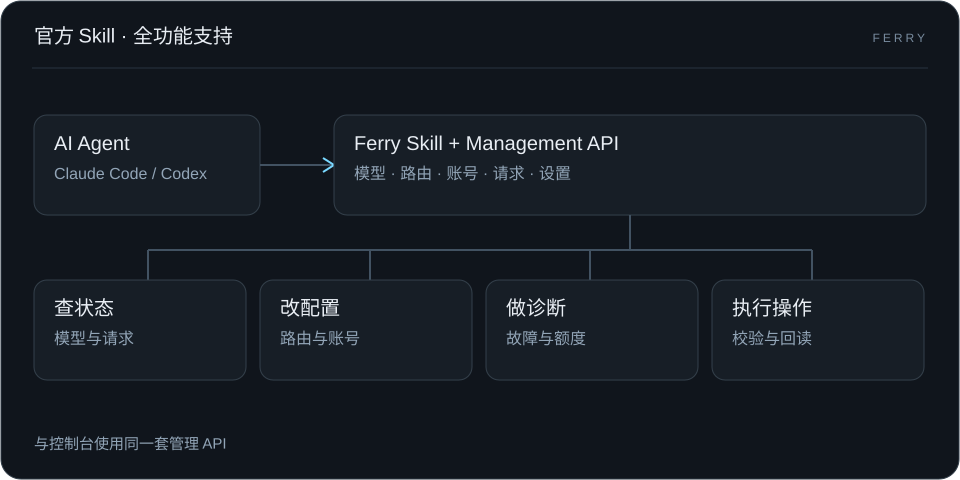
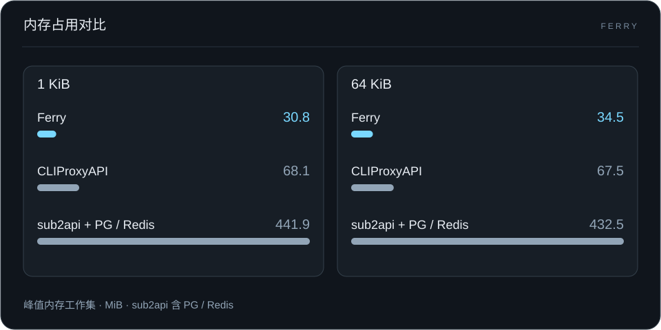
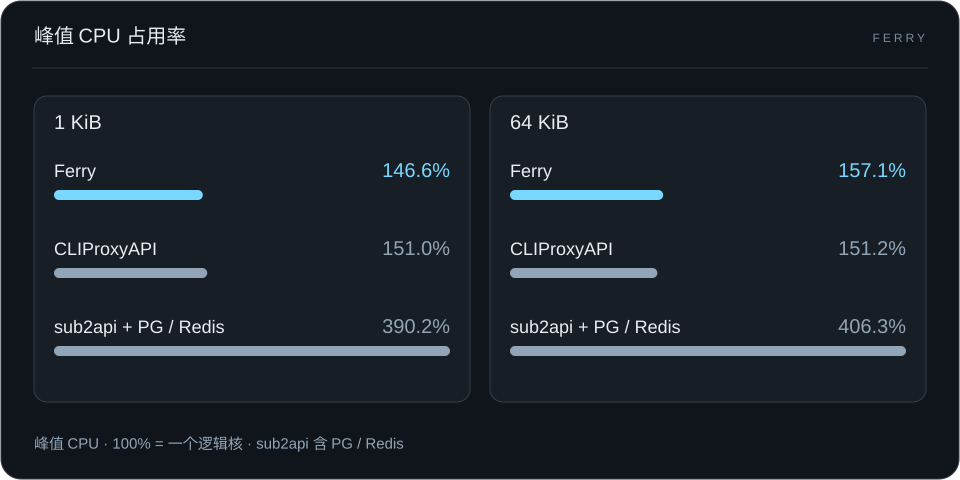
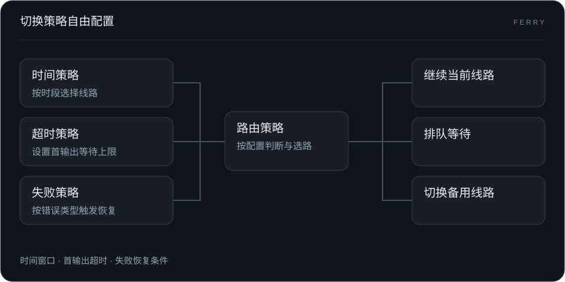

<p align="center"><picture><source media="(prefers-color-scheme: dark)" srcset="web/console/brand-reverse.svg"></picture></p>

# Ferry 渡口

**自托管 AI 网关，Go + SQLite，支持 Docker 和 headless 部署。**

为 AI 长任务设计的自托管网关。限流时等待，故障时接力，高峰时排队。客户端使用一个稳定入口，AI 通过 Skill 和管理 API 直接参与运维。

**中文** · [English](README.en.md)

[官网](https://ferry.bighulk.dev/) · **[开始使用 →](docs/guide/quickstart.md)** · [配置长任务恢复](docs/guide/long-tasks.md) · [让 AI 接手运维](docs/guide/agent-skill.md) · [全部文档](docs/README.md)


## 在自己的机器上开始

Go 单进程、嵌入式控制台、本地 SQLite，面向个人和小团队。运行时无需 Node.js 或外部数据库，上游凭据、配置和请求记录由你保管。


### Docker 两步启动

在空目录执行（需要 Docker 和 Compose）：

```sh
curl -fsSLo compose.yaml https://github.com/hulkbig/ferry/releases/latest/download/compose.yaml
docker compose up -d --no-build
```

打开 **<http://localhost:17910>** 创建管理员。无需源码、编译、`.env` 或独立数据库。推理 API 为 `http://localhost:17810/v1`，配置和记录保存在命名卷中。

**[Docker 安装、服务器访问与升级 →](docs/guide/docker.md)** · [首次请求](docs/guide/quickstart.md)

[参与开发与源码构建](docs/development.md)

### 连上你的 Agent

1. 在 **渠道（Providers）** 中添加上游，填写凭据、准确模型 ID 和协议。
2. 在 **模型与路由（Models & Routing）** 中检查路由并启用所需连接。
3. 在 **API 密钥（API Keys）** 中创建专用推理 Key，设置客户端的 Base URL、Key 和逻辑模型名。

先完成[第一个请求](docs/guide/quickstart.md)，再配置[备用路由和恢复条件](docs/guide/long-tasks.md)，用实际客户端验证工具调用与续轮。Key 可以限制模型、协议、有效期、RPM 和预算。

## AI First

### 官方 Skill，全功能支持

从模型、账号和路由配置，到请求诊断、额度管理和日常运维，Agent 通过官方 Skill 使用 Ferry 的完整管理能力。



[安装官方 Skill](docs/guide/agent-skill.md)

### 逻辑模型：对业务，不对上游

按业务定义模型入口。上游模型、账号和线路在 Ferry 内调整，业务端配置保持不变。


[配置逻辑模型](docs/guide/logical-models.md)

## 极致性能

### 内存占用更低

在 OpenAI Chat Mock 基准测试中，Ferry 峰值内存工作集为 **30.8–34.5 MiB**，比 CLIProxyAPI 低约 **49%–55%**，比 sub2api 整套服务低约 **92%–93%**。



### CPU 占用更低

Ferry 峰值 CPU 占用与 CLIProxyAPI 接近，低于 sub2api 整套服务：分别为 **146.6%–157.1%**、**151.0%–151.2%**、**390.2%–406.3%**。



基准测试：OpenAI Chat Mock · ARM64 · 并发 32 · 1 KiB / 64 KiB 响应 · 2026-10-30。[方法与完整数据](docs/guide/performance.md)

## 可靠请求

### 故障自动切换

首选上游故障时，自动尝试兼容的备用线路。


### 切换策略自由配置

按时间窗口、首输出等待上限和失败类型等条件，配置何时等待、何时切换。



[配置切换策略](docs/guide/long-tasks.md)

### 限流排队，少看 429

容量不足时按预算排队等待，容量释放后继续请求。


### 自动重置，额度保护

自动兑换可用的 Codex 重置券，结合配额保护，减少额度耗尽后的无效请求。


[自动重置](docs/guide/autoreset.md) · [额度保护](docs/guide/codex-usage-protection.md)

## 渠道与使用范围

API Key 渠道支持预设地址和自建兼容端点。原生账号驱动包括 Claude、Kimi 国内／国际、xAI、Meta、Vertex、Antigravity 和 Devin；Codex 使用独立 OAuth 流程。Ferry 不要求运行外部 CLIProxyAPI 服务。

新增原生驱动已通过离线测试，尚未逐一完成真实账号登录和推理验证。账号权限、模型开放范围及各驱动限制见[渠道支持](docs/provider-channel-coverage.md)。Ferry 不提供上游账号或额度。

<details>
<summary>部署前了解：数据、权限与费用</summary>

- 每个数据目录只运行一个实例，采用单管理员模式；不支持多个进程共享 SQLite 或多租户管理后台。
- 首次管理员由最先完成初始化的访问者创建。初始化前不要开放管理端口；远程访问应配置 TLS 和访问限制。
- 数据库包含凭据和业务记录，默认备份仅含当前配置与恢复凭据，均不提供静态加密；保留完整历史需显式添加 `-backup-history`。备份与恢复使用[内置命令](docs/guide/operations.md)，不直接复制运行中的 `.db` 文件。
- 费用统计依据用量记录和定价配置，不替代上游账单。恢复尝试、探测或自动消息可能产生额外调用。
- 并发控制用于管理请求节奏，不构成账号不会被封禁的保证。

</details>

## 一起让长任务少一次中断

一次可复现的工具续轮问题、一份准确的渠道能力证据、一段更清楚的安装说明，都能帮到下一个使用 Ferry 的人。参与方式见[贡献说明](CONTRIBUTING.md)。

| 下一步 | 文档 |
| --- | --- |
| 常见问题与故障排查 | [FAQ](docs/guide/faq.md) · [排障指南](docs/guide/troubleshooting.md) |
| 配置模型、连接与身份 | [配置说明](docs/guide/configuration.md) |
| 备份、升级和迁移 | [运维指南](docs/guide/operations.md) · [从 SmartAPI 迁入](docs/guide/migration.md) |
| 修改代码与运行检查 | [开发指南](docs/development.md) |
| 查看配图用途与来源 | [配图说明](docs/assets/README.md) · [资产来源](docs/asset-provenance.md) |

```sh
bash scripts/test.sh
```

完整检查需要 Go、Node.js、npm 和 Python 3。控制台没有 npm 运行依赖。

## 许可证

Copyright 2026 hulkbig。项目原创部分采用 [Apache-2.0](LICENSE)。第三方代码和资产保留各自许可证；OAuth 与部分原生协议代码参考或改写自 CLIProxyAPI，相关 MIT 声明见 [NOTICE](NOTICE) 和 [LICENSES](LICENSES)。安全问题处理见 [SECURITY.md](SECURITY.md)。
